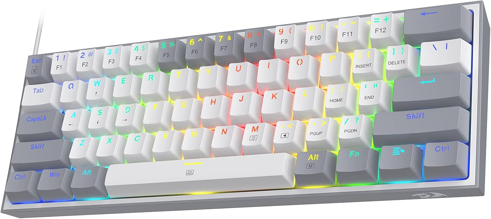
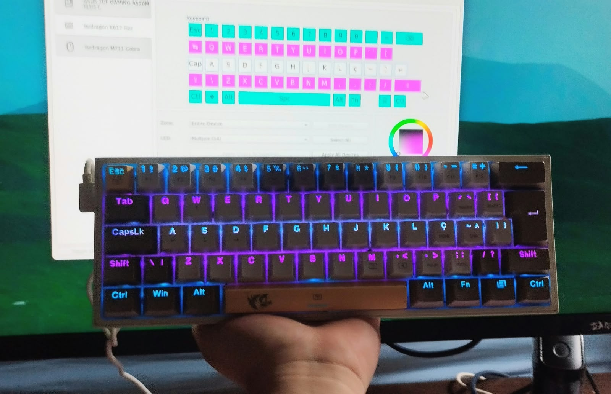

Se tem uma coisa que eu não gosto é software exclusivo. Sendo um usuário de Linux, depender de um programa de código fechado de algum vendor, seja pra controlar um hardware, seja um programa usado a fim de trabalho, é sempre o pior caso.

Tendo isso em mente, eu sou usuário de produtos Redragon já faz alguns anos. Teclado, mouse, já usei headsets também. São produtos com bom custo-benefício, baratos o suficiente pra eu não me incomodar com problemas de QA ou então com o software cagado deles. 

Depois de alguns anos usando uma máquina virtual com USB passthrough pra poder usar os softwares desses periféricos, eu resolvi deixar de ser vagabundo e realizar a engenharia reversa dos softwares e protocolos desses periféricos. Esse texto documenta meu processo implementando o protocolo *básico* de controle RGB do meu teclado, um Redragon Fizz K617-RGB



***

Resolvi começar investigando como o OpenRGB implementava o protocolo HID de um teclado, verificando no *lsusb*, o meu teclado foi detectado como um "258a:0049 BY Tech Gaming Keyboard"

Esses números são o identificador do fabricante, conhecido como VID, e o identificador do produto, ou PID. Eles ajudam a localizar o dispositivo, mas não bastam para determinar qual protocolo ele utiliza.

Verificando no código-fonte do OpenRGB, encontrei o seguinte:

### SinowealthControllerDetect.cpp
```cpp
#define SINOWEALTH_VID                      0x258A

// Sinowealth keyboards are disabled due to VID/PID pairs being reused from Redragon keyboards, which ended up in bricking the latter
//REGISTER_HID_DETECTOR_P("FL ESPORTS F11",                   DetectSinowealthKeyboard,   SINOWEALTH_VID, Fl_Esports_F11_PID,                             0xFF00          );
//REGISTER_HID_DETECTOR_P("Sinowealth Keyboard",              DetectSinowealthKeyboard16, SINOWEALTH_VID, RGB_KEYBOARD_0016PID,        
```

Como você pode ver, o próprio código do OpenRGB desabilita a identificação desse VID da Sinowealth (fabricante de chips controladores USB) porque encontraram problemas na comunicação com teclados desse vendor, o que levou ao bricking (inutilização) dos teclados.

Isso não é um bom começo, vamos analisar mais a fundo.
Novamente usando a linha de comando, extraí algumas informações que descrevem a comunicação USB do periférico (descriptors)

### sudo lsusb -v -d 258a:0049 > usb-descriptors.txt
```
Device Descriptor:
  idVendor           0x258a BY Tech
  idProduct          0x0049 Gaming Keyboard
  bcdDevice            1.01

Configuration Descriptor:
  bNumInterfaces          2

  Interface Descriptor:
    bInterfaceNumber        0
    bInterfaceClass         3 Human Interface Device
    bInterfaceSubClass      1 Boot Interface Subclass
    bInterfaceProtocol      1 Keyboard

  Interface Descriptor:
    bInterfaceNumber        1
    bInterfaceClass         3 Human Interface Device
    bInterfaceSubClass      0
    bInterfaceProtocol      0

    HID Device Descriptor:
      wDescriptorLength     227
      Report Descriptors:
        ** UNAVAILABLE **
```

O **VID/PID `258a:0049`** identifica o dispositivo, enquanto `bcdDevice` informa a revisão USB, não necessariamente a versão do firmware.

A **interface 0** atende ao funcionamento básico do teclado. A **interface 1** foi a utilizada pelo aplicativo para configurar a iluminação, conforme verificamos nas capturas.

O descritor de relatórios dessa segunda interface tinha **227 bytes**. Embora estivesse indisponível nesse dump, conseguimos recuperá-lo na captura USB e utilizá-lo como uma verificação adicional na detecção do teclado.

## Observando o aplicativo oficial com VirtualBox, usbmon e dumpcap

Para executar o software da Redragon, usei uma máquina virtual Windows no **VirtualBox**, com o teclado conectado à máquina virtual por passthrough direto USB.

A captura aconteceu no host Linux. Para isso, duas ferramentas são interessantes:

- **usbmon:** o mecanismo do kernel Linux que permite observar as transferências USB.
- **dumpcap:** ferramenta de captura distribuída com o Wireshark, usada para gravar essas transferências em um arquivo `.pcapng`.

Esse arranjo permitiu observar os comandos enviados pelo aplicativo Windows ao teclado, mesmo com o programa rodando dentro da máquina virtual.

Host Linux > usbmon > virtualbox-dkms > máquina virtual

Na primeira captura, o teclado estava no barramento USB 1. A interface correspondente era `usbmon1`. Um exemplo de comando para gravar o tráfego desse barramento é:

```
sudo dumpcap -i usbmon1 -w k617-first.pcapng
```

O parâmetro `-i` seleciona a interface e `-w` define o arquivo de saída. O formato padrão do dumpcap é pcapng. Para encerrar a captura, basta pressionar Ctrl+C, mas eu preferi usar o parâmetro  `-a duration:120` para encerrar a captura automaticamente após 2 minutos.

Com a captura em andamento, fiz uma sequência simples no aplicativo oficial:

1. Definir o teclado como vermelho.
2. Trocar para verde.
3. Trocar para azul.
4. Voltar para vermelho.

Eu queria produzir diferenças fáceis de identificar na captura final. Se os relatórios fossem praticamente iguais, os poucos bytes alterados seriam candidatos a representar a cor.

## Analisando os relatórios com tshark e Python

Para examinar os arquivos, usamos o **tshark**, a ferramenta de linha de comando do Wireshark. Ele permitiu filtrar as transferências relevantes e extrair campos específicos, sem precisar percorrer manualmente todos os pacotes.

As opções mais úteis foram:

- `-r`: abrir uma captura existente.
- `-Y`: aplicar um filtro de exibição.
- `-T fields`: apresentar campos selecionados em formato textual.
- `-e`: escolher quais campos extrair.

Por exemplo, este comando seleciona os relatórios maiores enviados ao dispositivo de endereço 4 na primeira captura:

```
tshark -r k617-first.pcapng \
  -Y 'usb.device_address == 4 && usbhid.setup.bRequest == 9 && usbhid.setup.wValue == 0x0306' \
  -T fields \
  -e frame.number \
  -e frame.time_relative \
  -e usb.data_fragment
```

O endereço USB pode mudar depois de reconectar o dispositivo. Nesse exemplo, `4` corresponde à primeira captura; na captura posterior, o teclado apareceu com outro endereço.

Também usamos **Python**, com módulos da biblioteca padrão como `subprocess`, `csv` e `pathlib`, para chamar o tshark, converter os dados hexadecimais em bytes e comparar os relatórios.

Isso tornou possível automatizar perguntas como: “Quais posições mudaram entre vermelho e verde?” ou “O segundo relatório vermelho é exatamente igual ao primeiro?”.

O **CFG do aplicativo da Redragon** responde isso. Ele continha o modelo do teclado, parâmetros de iluminação e índices associados às teclas. Esses índices eram candidatos a um mapa de LEDs, mas ainda precisavam ser confirmados pelas capturas.

## Encontrando os bytes da cor estática

O aplicativo enviava comandos HID do tipo **Feature Report** pela interface 1. Encontramos relatórios curtos de seis bytes e relatórios maiores de 1.032 bytes.

Um dos relatórios de iluminação começava com:

```
06 08 B8 00 40 00 00 00
```

Ao comparar os quatro momentos da sequência, encontramos três bytes que representavam a cor:

```
Vermelho: FF 00 00
Verde:    00 FF 00
Azul:     00 00 FF
```

Esses bytes estavam nos offsets 29, 30 e 31, contando o identificador do relatório como o primeiro byte. O segundo relatório vermelho era idêntico ao primeiro.

Criamos uma verificação em Python que reconstruía os quatro relatórios a partir dessa interpretação e exigia igualdade byte por byte. Assim, a hipótese sobre a cor ficou registrada como um teste executável.

## Implementando a comunicação com HIDAPI

A implementação foi feita em **C++**, dentro da estrutura de controladores do OpenRGB. Para conversar com o dispositivo, usamos a **HIDAPI**, que o projeto já utilizava.

As chamadas centrais foram:

```
hid_send_feature_report(...)
hid_get_feature_report(...)
```

A primeira envia um relatório ao teclado; a segunda solicita um relatório de resposta.

O controlador reproduziu a consulta de configuração observada no aplicativo oficial antes de aplicar uma mudança. A partir do perfil recebido, alterava os campos necessários para selecionar o modo de iluminação, preservando os demais campos desse perfil.

Também verificava o tamanho e os marcadores da resposta. Uma leitura inválida interrompia a sequência antes das escritas seguintes.

## Diagnosticando a primeira falha

O OpenRGB reconheceu o teclado, mas o primeiro teste de cor falhou.

Habilitei o **LogManager do OpenRGB** para identificar a etapa que havia falhado e os tamanhos das transferências. O diagnóstico passou a mostrar:

```
Profile response (report 06): returned 6 bytes, expected 262
```

Voltamos ao tshark para examinar o pedido de leitura do aplicativo oficial. Um comando usado para verificar esse detalhe foi:

```
tshark -r k617-first.pcapng \
  -Y 'frame.number == 44261' \
  -T fields \
  -e usbhid.setup.wValue \
  -e usbhid.setup.wIndex \
  -e usbhid.setup.wLength
```

A diferença estava no tamanho solicitado: o aplicativo pedia **1\.032 bytes**, embora a resposta recebida tivesse apenas **262 bytes**.

A primeira implementação havia usado o tamanho da resposta como tamanho da solicitação. Corrigimos a chamada para pedir o relatório completo, mantendo a validação da resposta de 262 bytes.

Depois de recompilar, a cor estática funcionou no teclado físico.

## Uma segunda captura para mapear as teclas

A primeira captura tinha algumas mudanças no modo personalizado, mas eu não havia registrado precisamente quais teclas alterei. Sabíamos quais bytes mudavam, porém não quais teclas representavam.

Fiz uma segunda captura, salva como `k617-specific.pcapng`, novamente com o aplicativo no VirtualBox e o tráfego observado no Linux.

Primeiro, deixei todas as teclas apagadas. Depois, alterei uma tecla por vez:

| Tecla | Cor hexadecimal |
|---|---|
| W | `12 34 56` |
| A | `65 43 21` |
| S | `22 44 66` |
| D | `66 33 22` |
| Escape | `13 57 24` |
| Ctrl direito | `24 68 13` |

Os valores diferentes em cada canal ajudaram a distinguir vermelho, verde e azul.

A comparação com tshark e Python revelou que os componentes não estavam organizados como trios RGB consecutivos. O relatório tinha **três planos de cor**, separados por 126 bytes.

Para uma tecla de índice `n`:

```
Azul:     8 + n
Verde:    8 + n + 126
Vermelho: 8 + n + 252
```

O relatório começava com:

```
06 09 BC 00 40 00 00 00
```

Os seis índices corresponderam exatamente ao último campo das respectivas entradas no CFG. Isso permitiu montar o mapa das demais teclas usando o mesmo campo.

## Testando sem acessar o hardware

Escrevi um teste em C++ com funções HID simuladas. Ele recebia pequenas amostras dos relatórios capturados e verificava os dados produzidos pelo controlador, sem abrir o dispositivo físico.

A compilação desse teste foi feita com **g++**:

```
g++ -std=c++17 -Wall -Wextra -Werror \
  -IControllers/RedragonK617Controller \
  -I/usr/include/hidapi \
  tests/RedragonK617ControllerTest.cpp \
  Controllers/RedragonK617Controller/RedragonK617Controller.cpp \
  -o build/check-k617

./build/check-k617
```

Também usei **AddressSanitizer** e **UndefinedBehaviorSanitizer** para verificar acessos à memória e comportamentos indefinidos.

Esses testes cobriam os relatórios estáticos, o padrão das seis teclas, a preservação do perfil e a interrupção das atualizações diante de falhas. Depois, eu verificava o resultado no teclado real.

## Compilando o OpenRGB com qmake e make

Para compilar o aplicativo completo, usamos o **qmake**, do Qt, para gerar o Makefile, e o **make** para executar a compilação.

Na minha máquina, o OpenRGB foi compilado com Qt 5, mas o compilador de traduções disponível era o `lrelease6`. Por isso, usamos:

```
mkdir -p build
cd build

qmake ../OpenRGB.pro QT_TOOL.lrelease.binary=/usr/bin/lrelease6
make -j3
```

O controlador passou a oferecer dois modos: **Static**, para uma cor global, e **Custom**, para cores individuais.

## Corrigindo o layout ABNT e a edição visual

O primeiro mapa tinha 61 teclas e seguia posições ANSI. No meu teclado ABNT, faltavam `\|` e `/?`.

O CFG já continha essas entradas adicionais, com índices 85 e 96. Incluímos ambas, chegando a **63 LEDs**, e posicionamos `]` diretamente abaixo de `[`.

Também reutilizei os nomes de teclas reconhecidos pelo OpenRGB para corrigir as legendas e permitir uma visualização mais adequada.

Com **Toggle LED View**, passei a clicar nas teclas do desenho, selecionar grupos arrastando o mouse e usar Ctrl para ampliar a seleção. Isso tornou a configuração muito mais prática do que escolher cada LED numa lista.



## Empacotando e instalando no Arch Linux

Depois dos testes físicos, usamos **makepkg** e um arquivo **PKGBUILD** para criar um pacote local do Arch Linux.

Esse pacote reúne o executável já compilado, o atalho de aplicativo, o ícone e as regras udev. A instalação foi feita com **pacman**, permitindo gerenciar o OpenRGB como um pacote do sistema.

As regras **udev** forneceram as permissões de acesso aos dispositivos. Com isso, a interface do OpenRGB podia funcionar no meu usuário normal.

## O resultado e os limites

Consegui controlar a iluminação estática e por tecla do meu K617 ABNT no Linux, incluindo as teclas adicionais e o mapa visual corrigido.

Ainda não implementei animações internas, ajuste de brilho, Direct streaming ou uma operação explícita de gravação no dispositivo. A persistência das alterações após desconectar o teclado e o efeito sobre outros presets também ainda não foram estabelecidos. Por ora, estou satisfeito com o resultado.

Link do repositório com o código e instruções para compilar:
[https://github.com/pedro-anthony/openRGB](https://github.com/pedro-anthony/openRGB)